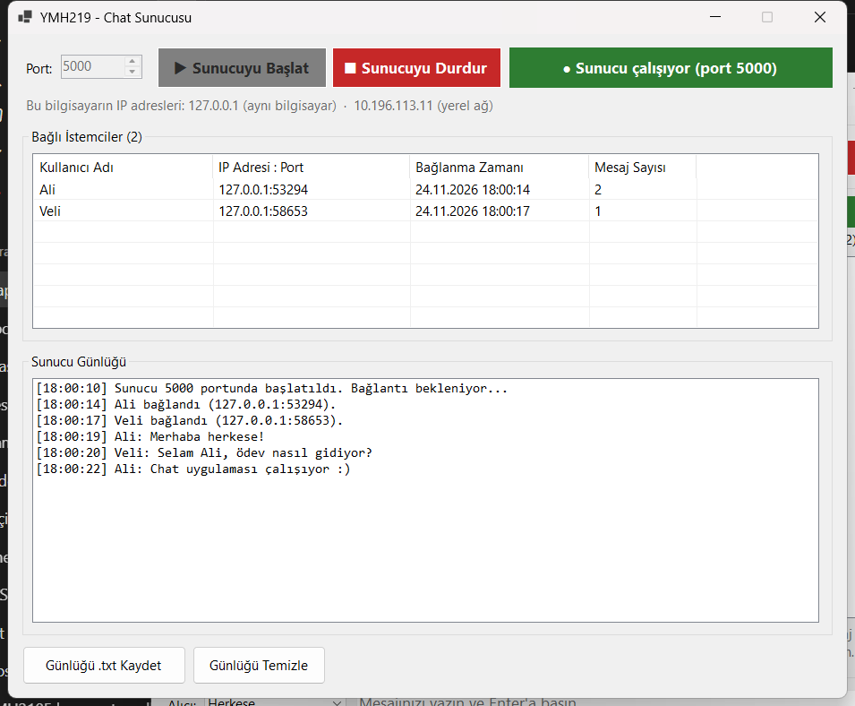
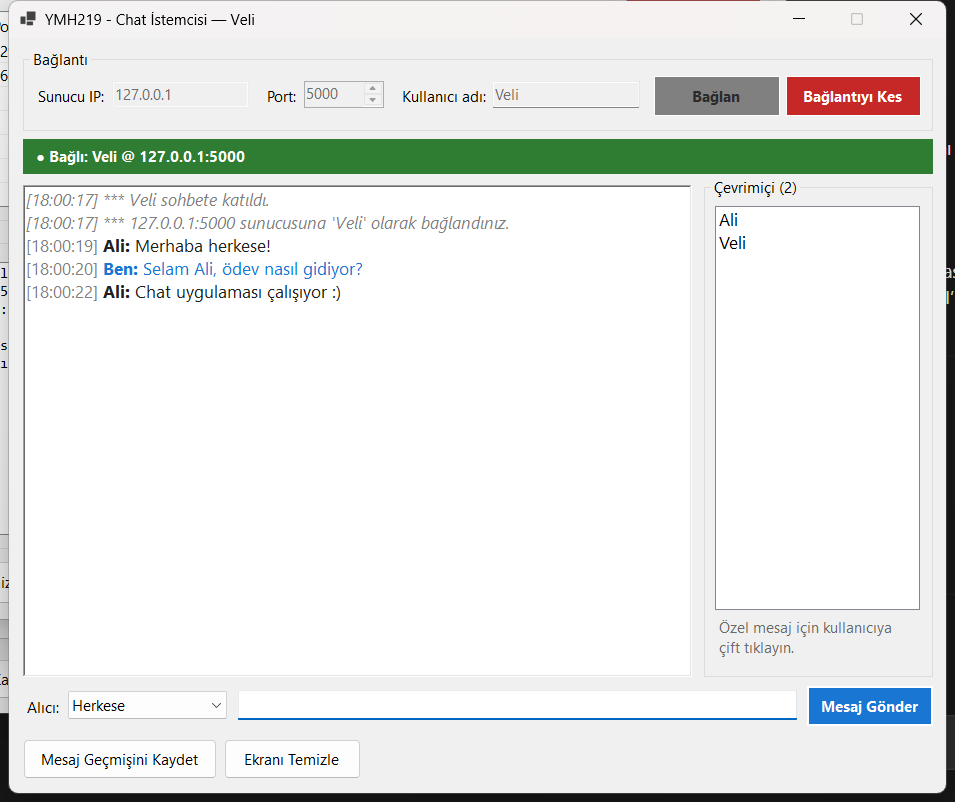
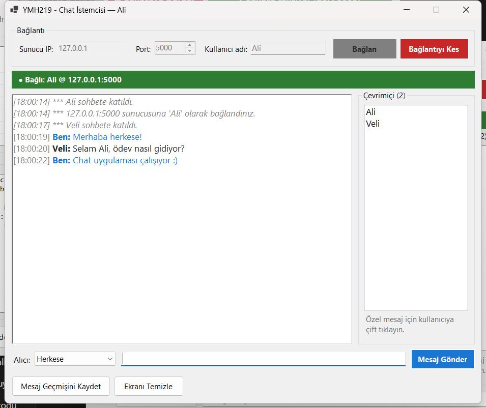

# YMH219-ChatApp

Nesne Tabanlı Programlama (YMH 219) dersi ek uygulama ödevi: **TcpListener / TcpClient** ile çalışan, Windows Forms arayüzlü bir **istemci-sunucu sohbet uygulaması**.

Bir sunucu uygulaması bağlantıları kabul eder; istemciler kullanıcı adıyla bağlanıp herkese ya da birbirlerine özel mesaj gönderebilir. Aynı bilgisayarda veya aynı yerel ağda çalışır.

## Kullanılan Teknolojiler

- C# / .NET 8 (`net8.0-windows`, ortak kütüphane `net8.0`)
- Windows Forms (ListView, ListBox, RichTextBox, ComboBox, NumericUpDown)
- `System.Net.Sockets`: `TcpListener`, `TcpClient`, `NetworkStream`
- `StreamReader` / `StreamWriter` (satır tabanlı iletişim)
- `async` / `await`, `CancellationToken`, `SemaphoreSlim`
- `System.Text.Json` (mesajların JSON'a çevrilmesi)
- Harici NuGet paketi **yok**

## Proje Yapısı

Çözüm üç projeden oluşur:

```
YMH219-ChatApp.sln
├── ChatCommon/                  Ortak sınıf kütüphanesi (sunucu ve istemci ikisi de kullanır)
│   ├── MessageType.cs           Mesaj türleri: Join, Chat, Private, System, UserList, Leave...
│   ├── ChatMessage.cs           Mesaj nesnesi + JSON dönüşümü + oluşturma metotları
│   ├── MessageConnection.cs     TcpClient'ı sarar: SendAsync / ReceiveAsync
│   ├── ChatProtocol.cs          Port, kullanıcı adı kuralları, mesaj uzunluğu
│   └── HistoryFileService.cs    Geçmişi / günlüğü .txt dosyasına yazma
├── ChatServer/                  Sunucu uygulaması
│   ├── ChatServer.cs            TcpListener, bağlantı kabulü, mesaj dağıtımı
│   ├── ClientSession.cs         Bağlı bir istemcinin bilgileri
│   └── ServerForm.cs            Sunucu arayüzü
└── ChatClient/                  İstemci uygulaması
    ├── ChatClient.cs            TcpClient ile bağlanma, gönderme, dinleme
    ├── ChatConnectionException.cs  Kullanıcıya gösterilecek anlaşılır bağlantı hatası
    └── ClientForm.cs            İstemci arayüzü
```

## Kurulum ve Çalıştırma

**Visual Studio ile**
1. Depoyu klonlayın: `git clone https://github.com/<kullanici-adi>/YMH219-ChatApp.git`
2. `YMH219-ChatApp.sln` dosyasını açın.
3. Çözüme sağ tıklayın → **Configure Startup Projects** → **Multiple startup projects** → `ChatServer` ve `ChatClient` için **Start** seçin.
4. `F5` ile çalıştırın. Ek istemci açmak için `ChatClient` projesine sağ tık → **Debug → Start New Instance**.

**Komut satırı ile** (her biri ayrı terminalde)
```
dotnet run --project ChatServer
dotnet run --project ChatClient
dotnet run --project ChatClient
```

**Kullanım**
1. Sunucu penceresinde portu seçin (varsayılan 5000) ve **Sunucuyu Başlat**'a basın.
2. İstemcide sunucu IP'sini (aynı bilgisayar için `127.0.0.1`), portu ve kullanıcı adını girip **Bağlan**'a basın.
3. Mesajı yazıp **Enter** veya **Mesaj Gönder**. Özel mesaj için **Alıcı** listesinden kişi seçin ya da kullanıcı listesinde isme çift tıklayın.

> **Yerel ağda çalıştırma:** İstemcide, sunucu penceresinde yazan "yerel ağ" IP adresini kullanın. Windows Güvenlik Duvarı ilk çalıştırmada izin isteyebilir; **Özel ağlar** için izin verin.

## Temel Özellikler

**Sunucu**
- Belirtilen portta `TcpListener` ile bağlantı kabul eder; aynı anda birden fazla istemciyi `async` olarak yönetir.
- Bağlı istemcileri tabloda listeler: **kullanıcı adı, IP:port, bağlanma zamanı, mesaj sayısı**.
- Bağlanma, ayrılma ve mesajları zaman bilgisiyle günlüğe yazar (özel mesajların içeriği yazılmaz).
- Aynı kullanıcı adıyla ikinci bağlantıyı ve geçersiz adları reddeder.
- Port kullanımdaysa uygulama kapanmadan hata gösterir.

**İstemci**
- Sunucu IP, port ve **kullanıcı adı** ile bağlanır.
- **Bağlan**, **Mesaj Gönder**, **Bağlantıyı Kes** işlevleri.
- Gönderilen ve alınan mesajlar **zaman bilgisiyle**, renkli olarak gösterilir (kendi mesajları mavi, özel mesajlar mor, sistem mesajları gri).
- Sunucu bulunamadığında, zaman aşımında, ad reddedildiğinde veya bağlantı koptuğunda **uygulama kapanmadan** anlaşılır mesaj gösterilir.
- Bağlantı durumu renkli durum çubuğu ve pencere başlığıyla gösterilir.

**İsteğe bağlı geliştirmeler**
- Birden fazla istemcinin aynı sohbet odasına katılması ve çevrimiçi kullanıcı listesi.
- Özel mesaj.
- Mesaj geçmişinin (istemci) ve sunucu günlüğünün `.txt` dosyasına kaydedilmesi.

## İletişim Protokolü

Her mesaj bir `ChatMessage` nesnesidir; JSON'a çevrilip **tek satır** olarak gönderilir:

```json
{"Type":"Chat","From":"Ali","To":"","Text":"Merhaba herkese!","Time":"2026-11-24T18:00:19","Users":[]}
```

| Akış | Mesajlar |
|---|---|
| Bağlanma | İstemci `Join` → Sunucu `JoinAccepted` veya `JoinRejected` |
| Katılım duyurusu | Sunucu herkese `System` ("Ali sohbete katıldı") + `UserList` |
| Herkese mesaj | İstemci `Chat` → Sunucu diğer herkese `Chat` |
| Özel mesaj | İstemci `Private` (To=Veli) → Sunucu yalnızca Veli'ye `Private` |
| Ayrılma | İstemci `Leave` → Sunucu herkese `System` + `UserList` |
| Sunucu kapanışı | Sunucu herkese `System` ("Sunucu kapatıldı"), bağlantıları kapatır |

## Ekran Görüntüleri

**Sunucu**: bağlı istemciler ve günlük



**İstemciler**

| Veli | Ali |
|---|---|
|  |  |

## Bilinen Sınırlamalar / Geliştirme Notları

- Tek bir ortak sohbet odası vardır; birden fazla oda desteği yoktur.
- İletişim şifrelenmez (düz TCP); yalnızca güvenilir yerel ağda kullanılmalıdır.
- Mesaj geçmişi sunucuda saklanmaz; sonradan bağlanan kullanıcı önceki mesajları göremez.
- Mesaj uzunluğu 500 karakter, kullanıcı adı 20 karakter ile sınırlıdır.

## Öğrenci

- **Ad Soyad:** Arda Yeşil
- **Öğrenci No:** 250542013
